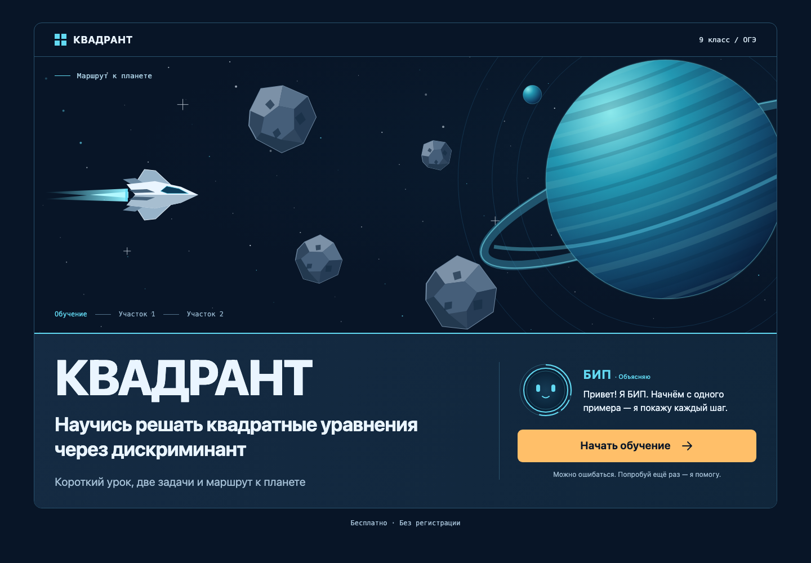

# КВАДРАНТ

[Открыть актуальную версию v2](https://quadrant-solver.pages.dev/) · [MVP v1](https://kvadrant-oge-mvp.pages.dev/) · [Исходники](https://github.com/Laskan0/kvadrant-oge-mvp)



Бесплатный браузерный тренажёр квадратных уравнений для 9 класса и подготовки к ОГЭ. React + TypeScript + Vite, CSS/SVG, KaTeX. Без backend, регистрации и runtime LLM.

## Текущее состояние

MVP v1 сохранён в ветке `main` и опубликован. Ветка `v2` добавляет знакомство с БИПом и новую компоновку практики; план и ход этой версии отмечаются в [PLAN.md](./PLAN.md).

- Пять шагов урока: коэффициенты, дискриминант, график трёх случаев, формула корней и мини-калибровка. Ответы сохраняются при возврате.
- Две практические задачи: сначала ввод D, затем двух корней. Проверка математическая; порядок корней не важен. Пустой и некорректный ввод обрабатывается отдельно.
- БИП объясняет материал, меняет выражение лица по смыслу реплики, помогает при ошибке и радуется успеху. В учебной секции он плавно перемещается между шагами.
- Подсказки раскрываются в две ступени отдельно для D и корней. Полный разбор доступен отдельным действием, не заполняет ответы и не пропускает задачу.
- После правильных корней появляются условные координаты и корабль автоматически летит дальше. Во время перелёта повторная отправка недоступна.
- Финал показывает завершённые участки и задачи с полным разбором/без него. Обычные подсказки на итог не влияют и в финале не упоминаются.
- Прогресс сохраняется в этом браузере: после перезагрузки открываются текущий экран и введённые ответы. Повтор практики или теории начинает соответствующую часть заново.

Основной пользовательский путь реализован. Сборка, unit- и E2E-проверки проходят; адаптивность и доступность проверены автоматизированно. Перед сдачей остаются запись экрана (пользователь готовит сам) и короткое описание принятых решений. Настоящее мобильное устройство и ручная проверка скринридером не проверялись.

## Локальный запуск

Проверено на Node.js 25.9.0 и npm 11.12.1. Точные версии зависимостей записаны в package-lock.json.

```sh
npm ci
npm run dev
```

Адрес разработки: http://127.0.0.1:5173. При занятом порте Vite покажет другой адрес.

```sh
npm test
npm run build
npm run preview
```

Сборка проверяет TypeScript и создаёт статические файлы в `dist`. Урок и практика загружаются отдельными модулями; растровая концепция в runtime не используется.

## Тесты

71 сохранённый unit-тест Vitest:

- `src/logic/math.test.ts` — 48 проверок математики и числового ввода.
- `src/logic/lesson.test.ts` — 6 проверок состояния урока.
- `src/logic/practice.test.ts` — 8 проверок практики, подсказок и разбора.
- `src/logic/navigation.test.ts` — проверки переходов, знакомства, повторных событий, результатов и сброса.
- `src/logic/persistence.test.ts` — 2 проверки восстановления и обработки повреждённого сохранения.

Playwright проверяет полный путь и клавиатуру на 360, 390, 768 и 1440 px: ошибки, исправления, график, подсказки и разбор, финал, повтор и доступность. Реальный iPhone пока не проверен.

## Математика и данные

`src/logic/math.ts`: `parseNumber`, `getDiscriminant`, `solveQuadratic`, `checkDiscriminant`, `checkRoots`. Абсолютный допуск сравнения — 1e-9 для небольших чисел заданий. Принимаются пробелы по краям, отрицательные числа (включая знак −), десятичная точка или запятая. Формулы, дроби, экспоненты, разделители тысяч и нечисловые значения отклоняются. Некорректные коэффициенты (`a = 0`, NaN, бесконечность) вызывают RangeError как ошибку данных задания.

SVG-график вычисляется по y = x² − 4x + c с одинаковым масштабом для c = 3/4/5. В KaTeX передаются только фиксированные формулы приложения. Космическая сцена не имеет координатной сетки: координаты — условное обозначение результата, положение объектов выбирается для композиции.

## Документы

- [Исходное ТЗ](./kvadrant_mvp_10_12h_v3.md)
- [План и прогресс](./PLAN.md)
- [Согласованный сценарий](./SCENARIO.md)
- [Визуальная концепция и сверка](./design/DESIGN.md)
- [Знакомство v2](./docs/screenshot-v2-briefing.png) · [Практика v2, десктоп](./docs/screenshot-v2-practice.png) · [Практика v2, мобильный экран](./docs/screenshot-v2-practice-mobile.png)

Исходники: [Laskan0/kvadrant-oge-mvp](https://github.com/Laskan0/kvadrant-oge-mvp), ветка [v2](https://github.com/Laskan0/kvadrant-oge-mvp/tree/v2). Инструкция публикации: [DEPLOY.md](./DEPLOY.md). Актуальная версия v2: [quadrant-solver.pages.dev](https://quadrant-solver.pages.dev/); исходный MVP v1: [kvadrant-oge-mvp.pages.dev](https://kvadrant-oge-mvp.pages.dev/). Видео пользователь готовит сам.

## Сохранённые браузерные проверки

Помимо 71 unit-теста, сохранены 20 E2E-проверок Playwright (четыре сценария в пяти конфигурациях). Они проверяют знакомство и выражения БИПа, его переход к каждому новому блоку формулы, приборную панель практики, полный путь, восстановление прогресса, клавиатуру и axe-core. Chromium: 1440/768/360 CSS px; WebKit: эмуляция iPhone 390 CSS px; дополнительно — reflow при 720 CSS px и DPR 2. Последняя конфигурация приближает проверку 200% масштаба, но не является изменением браузерного zoom. Реальное устройство не проверялось.

```sh
npx playwright install chromium webkit
npm run test:e2e
```

Для публичного сайта:

```sh
KVADRANT_BASE_URL=https://quadrant-solver.pages.dev npm run test:e2e
```

Реальный iPhone с экранной клавиатурой и ручное прохождение со скринридером не проверялись. Высота доступной области моделируется в тесте отдельно; это не эмуляция самой клавиатуры iOS. Запись видео пользователь готовит самостоятельно.
